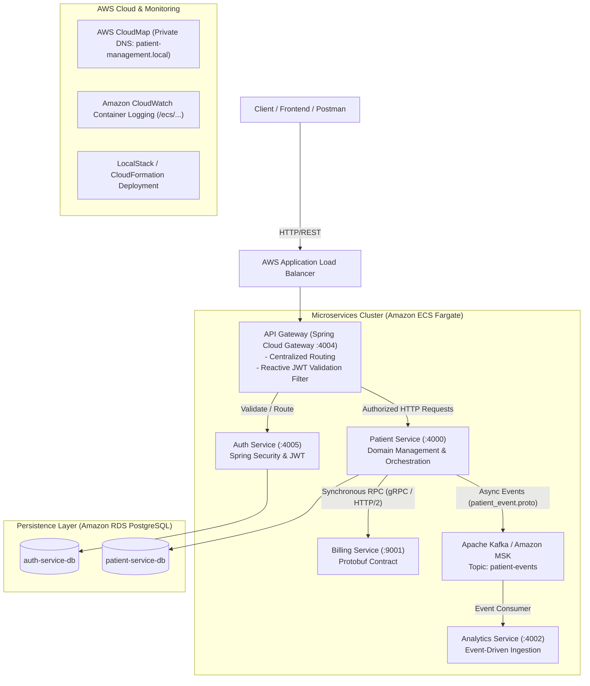

# Distributed Patient Management Microservices Platform

[](https://www.oracle.com/java/)
[](https://spring.io/projects/spring-boot)
[](https://spring.io/projects/spring-cloud)
[](https://grpc.io/)
[](https://kafka.apache.org/)
[](https://aws.amazon.com/cdk/)
[](https://www.postgresql.org/)
[](https://www.docker.com/)

A cloud-native, event-driven healthcare backend platform built with **Java 21**, **Spring Boot 3.4**, **gRPC**, and **Apache Kafka**. The platform is architected as decoupled microservices and fully automated with **Infrastructure as Code (AWS CDK in Java)** for containerized deployment across **Amazon ECS Fargate**, **Amazon RDS**, and **Amazon MSK**.

---

## 🏛 System Architecture

The system decouples core healthcare operations into specialized microservices, utilizing synchronous RPC (gRPC) for mission-critical operations and asynchronous messaging (Kafka) for event streaming:



---

## 🚀 Microservices Breakdown

| Service | Port | Communication | Description |
| :--- | :--- | :--- | :--- |
| **API Gateway** | `4004` | REST / Reactive | Central entry point built with **Spring Cloud Gateway**. Enforces reactive JWT token authentication via a custom `GatewayFilterFactory` before routing to downstream services. |
| **Auth Service** | `4005` | REST | Manages user registration, credential verification, and token issuance using **Spring Security 6**, **BCrypt**, and **JJWT (0.12.6)** with PostgreSQL persistence. |
| **Patient Service** | `4000` | REST, gRPC, Kafka | Core CRUD microservice for patient records with bean validation (`@Valid`), JPA/Hibernate persistence, an integrated gRPC client for billing, and a Kafka producer. |
| **Billing Service** | `4001` (HTTP)<br/>`9001` (gRPC) | gRPC (HTTP/2) | High-throughput gRPC provider service utilizing **Protocol Buffers** (`billing_service.proto`) for deterministic, low-latency invoice and billing generation. |
| **Analytics Service** | `4002` | Kafka Consumer | Event-driven microservice consuming protobuf-serialized events (`patient_event.proto`) from Kafka topics for downstream auditing and metrics. |
| **Infrastructure** | N/A | AWS CDK (Java) | Infrastructure as Code defining multi-AZ VPC, Amazon ECS Fargate clusters, RDS PostgreSQL, Amazon MSK, ALB, and CloudWatch log groups. |
| **Integration Tests** | N/A | REST Assured | Automated end-to-end test suite validating auth flows, RBAC enforcement, and patient lifecycle operations. |

---

## 🛠 Tech Stack & Engineering Highlights

* **Language & Runtime:** Java 21 (LTS)
* **Frameworks:** Spring Boot 3.4.1, Spring Cloud Gateway (2024.0.0), Spring Data JPA, Spring Security 6
* **Inter-Service Communication:**
  * **gRPC & Protocol Buffers (Protobuf v4.29.1):** Binary serialization over HTTP/2 for low latency and backward-compatible schemas.
  * **Apache Kafka (Spring Kafka 3.3.0):** Distributed messaging queue for event-driven asynchronous processing.
* **Database & Persistence:** PostgreSQL 17.2, Hibernate ORM, HikariCP connection pooling.
* **Cloud & DevOps:**
  * **AWS CDK v2 (Java):** Fully typed Infrastructure as Code.
  * **Amazon ECS Fargate:** Serverless container orchestration.
  * **AWS Application Load Balancer (ALB):** Public traffic termination and routing.
  * **AWS CloudMap:** Microservices internal service discovery (`patient-management.local`).
  * **Amazon MSK:** Managed Kafka cluster provisioning.
  * **LocalStack:** Local AWS emulation for CloudFormation deployment testing.
* **Testing:** REST Assured, JUnit 5, Reactor Test.

---

## 📂 Repository Structure

```
├── api-gateway/            # Spring Cloud Gateway with custom JWT pre-filter
├── auth-service/           # Spring Security, JWT authentication, and user persistence
├── patient-service/        # Patient domain service, gRPC client, Kafka event producer
├── billing-service/        # gRPC server with Protocol Buffers for billing logic
├── analytics-service/      # Kafka consumer for patient analytics events
├── infrastructure/         # AWS CDK stack in Java (ECS, RDS, MSK, ALB, VPC)
├── integration-tests/      # End-to-end integration tests using REST Assured
├── api-requests/           # Sample HTTP requests for testing endpoints
└── grpc-requests/          # Sample gRPC requests for billing verification
```

---

## ⚡ Getting Started

### Prerequisites
* **Java 21** or later
* **Maven 3.9+**
* **Docker & Docker Compose**
* **AWS CLI** & **LocalStack** (for cloud deployment simulation)

### 1. Build All Services
Run Maven build from the root or within individual service directories:
```bash
mvn clean package -DskipTests
```

### 2. Running Microservices Locally with Docker
Each microservice includes a production-ready `Dockerfile`. Build and run containers individually or use LocalStack:
```bash
# Example building Patient Service
cd patient-service
docker build -t patient-service .
```

### 3. Deploying Cloud Infrastructure via AWS CDK (LocalStack)
The infrastructure module synthesizes CloudFormation templates and deploys to LocalStack:
```bash
cd infrastructure
mvn clean package
cdk synth

# Deploy to LocalStack
./localstack-deploy.sh
```

---

## 🔒 Security & Authentication Architecture

1. **Client Request:** Incoming requests hit the **Spring Cloud Gateway** (`:4004`).
2. **Gateway Filter:** The custom `JwtValidationGatewayFilterFactory` extracts the `Authorization: Bearer <TOKEN>` header.
3. **Validation:** The token is validated against the secret signature and parsed for user role claims (`ADMIN`, `USER`).
4. **Header Enrichment:** If valid, the Gateway forwards enriched headers (`X-User-Role`, `X-User-Id`) to internal services residing in private subnets.

---

## 🧪 Automated Testing
End-to-end integration tests verify service orchestration without manual intervention:
```bash
cd integration-tests
mvn test
```
Tests validate:
* Successful user registration & authentication (`AuthIntegrationTest`).
* JWT retrieval and authorization boundary checks.
* Patient creation, gRPC billing interaction, and Kafka event publishing (`PatientIntegrationTest`).
